# Attribute Table Studio

One QGIS plugin, one toolbar, four tools for working with attribute tables:

| | Tool | What it does |
|---|---|---|
|  | **Attribute Explorer** | A fast attribute table with exact statistics attached above every column, a typed filter under every heading and a full editing mode. |
|  | **Pivot Table** | Grouped summaries and cross tabs with correct totals, an explicit input scope and drill-through to the contributing records. |
|  | **Data Plot** | Plots of a layer's records: the twelve chart types of ArcGIS Pro (bar, line, combo, pie, histogram, box, scatter, scatter matrix, data clock, calendar heat, matrix heat, QQ) with their options. |
|  | **Geometry and Table Compare** | OLD → NEW comparison of two dataset versions: added, deleted, modified and unchanged features, field-level changes, geometry review points. |

Supports **QGIS 3.40 LTR+ (Qt5) and QGIS 4.x (Qt6)**, light and dark themes.

**New in version 1.4**: **Data Plot**, a fourth tool for plots of a layer's
records: bar, line, combo and pie charts, histograms, box plots, scatter
plots and scatter plot matrices, data clocks, calendar and matrix heat
charts and QQ plots, with ArcGIS Pro's options for each, live records
(all, Explorer filtered, selected or the map extent) and selection both
ways. Attribute Explorer opens it from a new **Data Plot** button in its
top bar. The settings cards of Visualize Statistics and the Pivot Table
chart now line their boxes up. Version 1.3 brought Freeze Column, the Pivot
Table chart, Compare's changed fields and a much faster Attribute Explorer
on big layers. The full list of changes is in the changelog of
`metadata.txt`.

Inspired by Microsoft's [Data Wrangler](https://marketplace.visualstudio.com/items?itemName=ms-toolsai.datawrangler)
extension for Visual Studio Code — see [Acknowledgements](#acknowledgements).

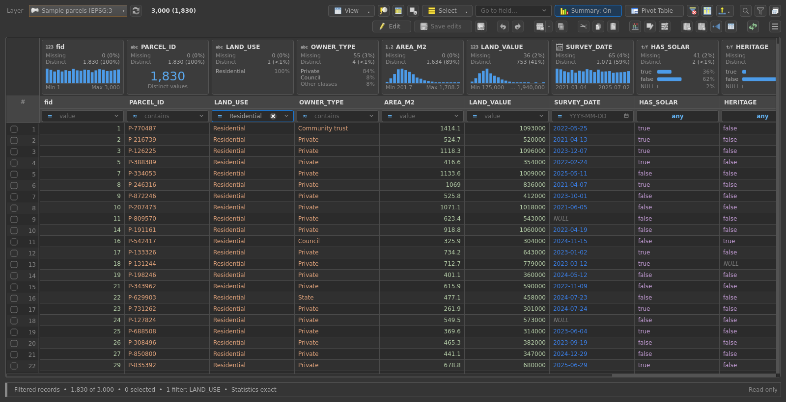

## Install

1. Build the zip: `python scripts/package.py` → `dist/attribute_table_studio-1.4.zip`
2. QGIS → *Plugins › Manage and Install Plugins › Install from ZIP*.
3. If the standalone *Geometry and Table Compare* plugin is installed, disable
   it — Attribute Table Studio includes it (the plugin warns when both are enabled).

## Windows and docking

Every tool opens in **its own window** (own taskbar entry) that remembers its
size and position. The **Dock** button at the top right of each tool docks it
into the QGIS main window — and undocks it again — keeping filters, results
and selections. *Plugins › Attribute Table Studio › Settings* can open each tool
docked by default, like *Open attribute table as docked window* in QGIS.

## Help

Every tool has its own **Help**: the ? button at the top right (in Attribute
Explorer, *☰ › Help*). It has a tab for each part of the tool — Attribute
Explorer: Overview, Statistics & filters, Selection, Editing, Quick update &
Find; Visualize Statistics: Chart, Settings; Pivot Table: Overview, Build your
table, Result, Chart; Data Plot: Overview and one tab per plot type; Compare:
Setup, Results, Review. Each tab shows a picture
of that part with red numbered badges and, beside it, what every number does.
Drag the divider (or make the window bigger) to enlarge the picture. The last
tab, **More details**, keeps the full written help.

## Attribute Explorer

Open it from the toolbar, the plugin menu, a vector layer's right-click menu
(*Open in Attribute Explorer*) or the keyboard shortcut (**Ctrl+Alt+T** is
proposed and only assigned when no other command uses it; change it in
*Settings › Keyboard Shortcuts*). Each layer gets its own explorer. The
number beside the Layer box is the layer's record count, followed in brackets
by the records shown in the table when that is different: **9,434 (484)**.

- **Column profiles** above every column: missing (NULL) and distinct counts,
  top categories with shares of non-NULL values, histograms with min / max,
  earliest / latest dates, true / false counts. Hover a bar for its count,
  the rest of the card for a brief summary. Click a profile for full
  statistics (sum, mean, median, population standard deviation, searchable
  frequency list, blank and whitespace values, histogram bins); both tables
  are selectable (Ctrl+C), and **Copy ▾** / **Export ▾** copy or save the
  summary, the distribution or everything (Excel workbook with Summary and
  Distribution sheets, or CSV; shares as numbers, scope recorded).

  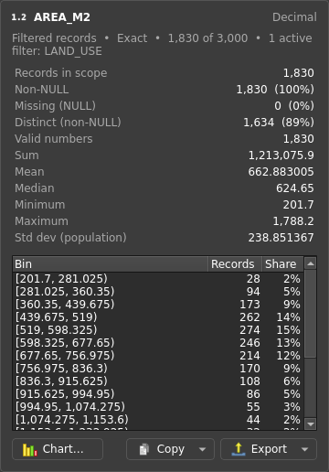
- **Filters** under every heading — text: contains, does not contain,
  equals, is not, starts with, is one of, is not one of, is NULL, is not NULL;
  numbers: =, ≠, <, ≤, >, ≥, between, is one of, is not one of; dates: on,
  before, after, between (calendar, YYYY-MM-DD hints); booleans: true, false,
  NULL. The "not" filters keep the NULL records (a NULL value is not
  'Residential'), unless NULL is one of the values left out.
  Columns combine with AND, values within a column with OR. Invalid input is
  outlined red and the last valid result stays. The ✕ in a filter box clears
  it (also for *is one of*); the value list sorts by value or by records.
- **Scope rules**: profiles describe exactly the filtered records (not just
  the visible screen). NULL is missing; zero and empty text are values.
  Sorting and hiding columns never change the population.
- **Big layers**: the records show first, then all the shown columns'
  statistics come from one read of the layer, numbers and dates kept as
  8-byte values and text counted as it is read (the same exact statistics).
  Those values are **kept**, within a memory budget (Settings › *Memory for
  fast filters*: automatic, about 10 % of the computer's memory), so a
  filter, a View scope or a drill-through works out its statistics without
  reading the layer again, and a sort by a kept column is a numpy sort that
  never freezes QGIS. Any edit or field change lets the kept values go (the
  next read keeps them again); closing the explorer gives the memory back.
  In tests with 10 million records (5 fields): statistics ready after 78 s
  instead of 185 s, a filter 14 s instead of 125 s (a second one 6 s), a sort
  3.5 s instead of 27 s, peak memory 1.0 GB instead of 3.1 GB.
- **Selection** stays in sync with the map: select features with the row tick
  boxes / numbers (a click selects only that row, Ctrl adds or removes, Shift
  or a drag extends, also while editing). A click on a cell only frames it,
  as while editing: the arrow keys move the frame and *Ctrl+C* copies the
  cell's value. A feature selected on the map scrolls its row into view; a
  sort or a filter shows the top, or the first selected feature.
  *Selected only* limits table and statistics to the selection. Filtering
  never changes the map selection.
- **Map filter** (the outline funnel next to *Dock*, the mark QGIS shows beside
  a filtered layer): a quick, temporary filter of the map. While it is on, the
  map shows only the records of the table filters and follows them as they
  change. It is written as readable SQL where the layer's format answers
  exactly like the table (otherwise as a list of feature ids), on top of any
  Query Builder filter the layer already has. Turning it off, closing the
  explorer or switching it to another layer shows every feature again and
  gives the layer exactly its own filter back; the table keeps its filters
  until *Clear filters*. A project saved meanwhile keeps only the layer's own
  filter, and a Query Builder change made while it is on wins (the map filter
  goes off). It is frozen while the layer is being edited, since QGIS allows
  no filter changes then; an explorer closed during editing gives the filter
  back as soon as editing stops.

  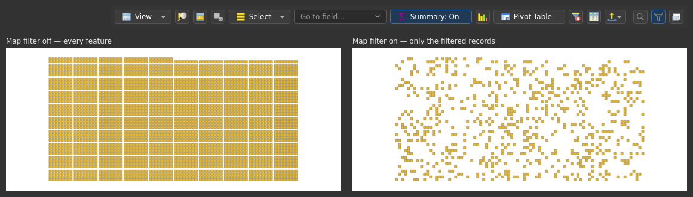
- Click a column name to select the whole column (Ctrl / Shift+click for
  more; Ctrl+C copies their values with the field names); double-click it to
  sort (ascending, descending, off). Drag to reorder, *Columns* to show / hide /
  reorder (Shift+click selects a range of fields, Ctrl+click adds one; Space or
  *Toggle Selection* ticks them together); layouts are saved with the layer in
  the project.
- **Freeze Column** (right-click a column name), as in ArcGIS Pro: the column
  moves to the left edge and stays there, with its statistics and filter,
  while the other columns scroll; freeze several, in the order you want them.
  **Unfreeze Column** lets it scroll again as the first scrolling column;
  **Unfreeze All Columns** frees them all. Only the view changes, never the
  layer's field order, and frozen columns are kept with the column layout.
- **Rename Field…** (right-click a column name) renames the field in the
  layer, as QGIS's Fields tab does: it starts editing when needed, checks the
  new name as you type (empty, already used, too long for a shapefile's 10
  characters) and is one undo step, written by *Save edits*. The column keeps
  its filter, width, place and sort.
- **Go to field**: type part of a field name (or alias) and pick it from the
  list — type icon, name and QGIS type on each line, hidden columns marked —
  to scroll the table so that column is in the middle, with its heading
  briefly highlighted. A hidden column is shown again. ↑ / ↓ and Enter work
  too; Enter without the list goes to the first match.
- **Find and Replace** (the magnifier left of the map filter, *Ctrl+F*;
  *Ctrl+H* adds Replace): a find bar like VS Code's at the top right of the
  rows. It finds the text in every cell shown (as the table shows it),
  ignoring case unless *Match case*; *Match whole cell* and *Regular
  expression* refine it. Matches are tinted and counted, *Enter* / *Shift+Enter*
  (or F3) move between them and *Escape* closes the bar. While editing,
  *Replace* changes the framed match and *Replace All* every match in the
  records shown, as one undo step, in editable text fields only.

  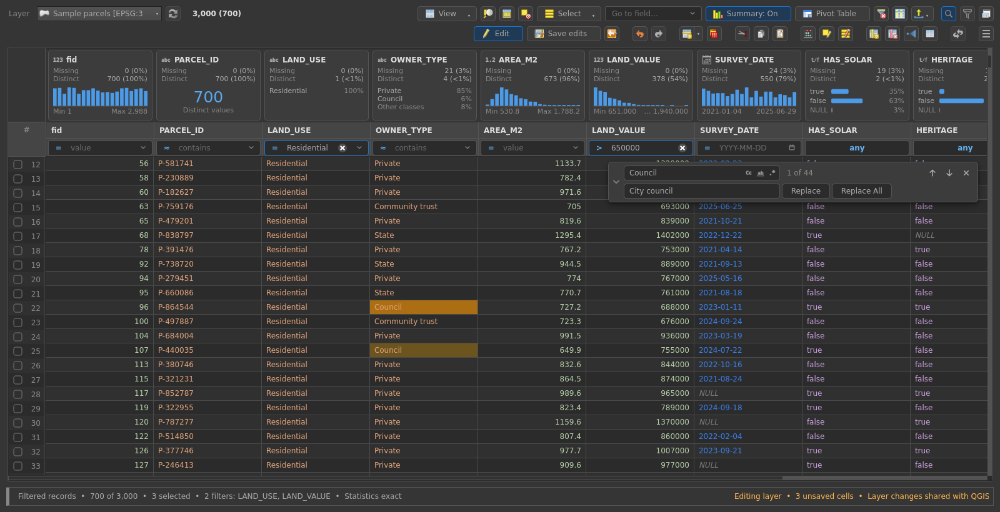
- *Ctrl+Home* / *Ctrl+End* jump to the first / last record, *Page Up* /
  *Page Down* move a page; right-click the scroll bar for *Top* / *Bottom*.
- *Layer* switches the Explorer to another layer; the refresh icon beside it
  loads the layer selected in the Layers panel (greyed out when that layer is
  already shown or is not a vector layer or table).
- The top row, right aligned: *View ▾*, *Zoom to selection*, *Selected only*
  and *Deselect features from the current layer* (icons), *Select ▾*, *Go to
  field*, *Summary*, *Visualize Statistics* and *Data Plot ▾* (icons),
  *Pivot Table*, then *Clear filters*, *Columns* and *Export ▾* (icons),
  *Find and Replace*, the map filter and *Dock*.
- *Export ▾* to Excel or CSV with the scope recorded, or copy the selected
  rows (*Ctrl+Shift+C*); *Pivot Table* hands the filtered records to the Pivot
  Table, and *Data Plot ▾* (a plot type, or *Open Data Plot*) to Data Plot.
- Menus are written the way QGIS writes them (Title Case; "…" when the entry
  opens a dialog).
- **View ▾** (before *Select ▾*): *Table View* or *Form View*; the scopes with
  the names and icons of the QGIS attribute table (*Show All Features*, *Show
  Selected Features*, *Show Features Visible on Map*, *Show Features with
  Failing Constraints*, *Show Edited and New Features*); *Advanced Filter
  (Expression)* (an editable expression bar, below), *Stored Filter Expressions…*, *Filter
  by Form…*, *Case-Sensitive Text Filters*, *Move Selection to Top*, *Sort by
  Expression…*, *Conditional Formatting…*, *Autosize All Columns*. Column
  filters always apply on top of the scope.
- **Select ▾**: *Select All Features*, *Invert Selection* (each also for the
  *Whole Layer* while the table is filtered), *Deselect Features from All
  Layers*, *Select Features by Expression…*, *Select Features by Value…*,
  *Pan to Selection*, *Zoom to Selection*.

### Visualize Statistics

Click the chart icon beside **Σ Summary** (it charts the selected column),
right-click a column name › **Visualize Statistics…**, or click **Chart…** in a
column's statistics popup for a full chart of that column, for the records
the explorer shows. It follows the explorer's filters, scope and edits; one
chart window per explorer, as a window or docked.

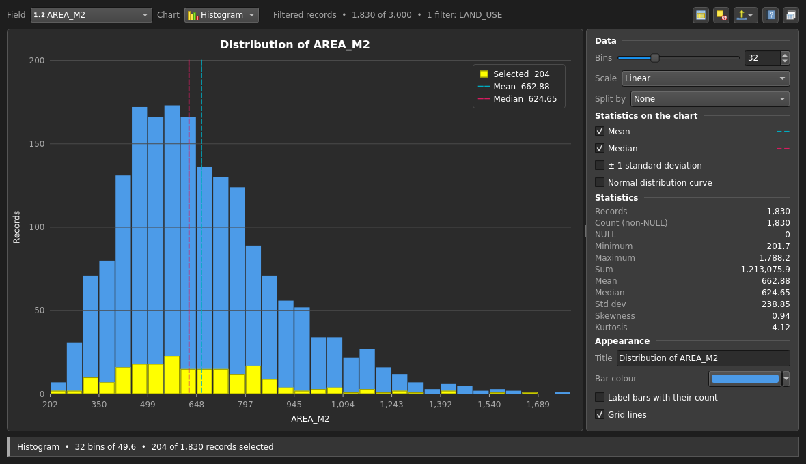

- **Chart**: every field can be a **Histogram** (vertical columns) or a
  **Bar chart** (horizontal bars). Numbers: bins from the minimum to the
  maximum (mean and median lines, ± 1 standard deviation, a normal
  distribution curve), or one bar per value (handy for codes). Text and
  true / false: one bar or column per value (top 10 or 25 and Other, or all
  values; records or shares; NULL as a bar), names slanted under columns
  when they don't fit. **Sort** as in ArcGIS Pro: A → Z, Z → A, fewest or
  most records first (the default), or a custom order you drag into place. Dates: records per day, week, month, quarter or year.
  Text starts as a bar chart, numbers and dates as a histogram. Linear,
  logarithmic or square root scale.

  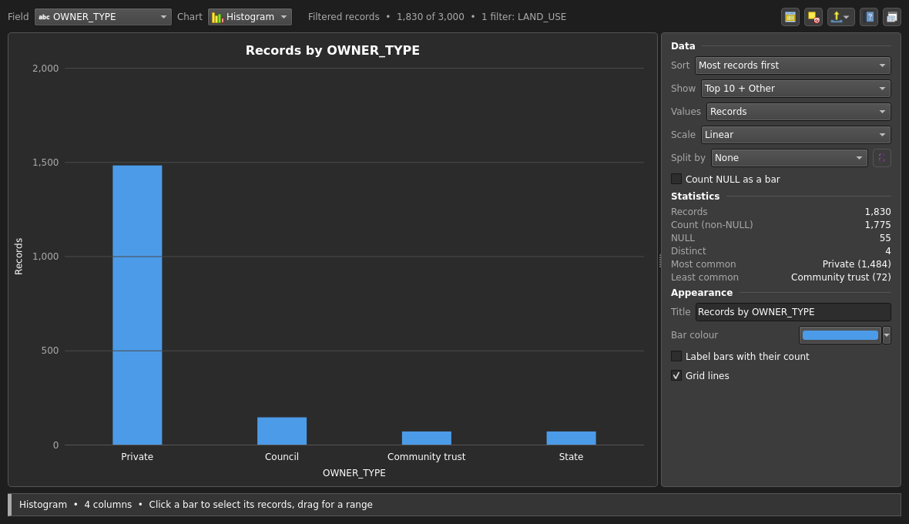
- **Click a bar** to select its records on the layer (the map and the table
  follow), **Ctrl+click** to add one, **drag** for a range. Bars are always
  solid; the selected records of every bar are drawn from its base in the
  project's selection colour, also for a selection made on the map, so a bar
  can be partly selected. **Selected only** charts just the selection.
- **Split by** a second field or an expression (the ε button opens the QGIS
  expression builder), stacked or side by side: the 8 most common values get
  colours checked for colour-blind readers, the rest form Other; a click on a
  legend entry selects that value in every bar.

  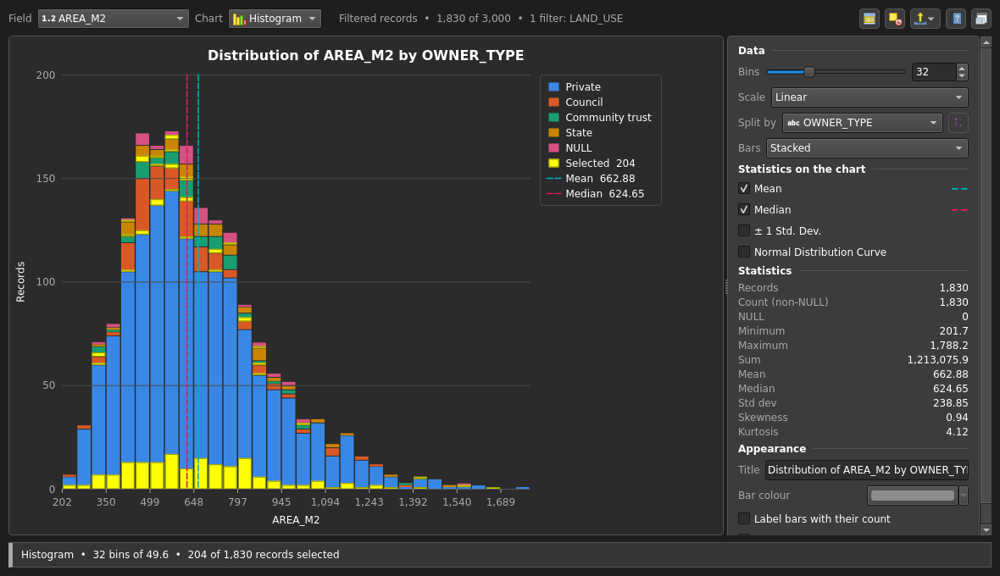
- **Statistics** as in the explorer, plus skewness and kurtosis; **Export**
  saves a PNG or SVG image, copies it, or writes the bars to CSV with the
  scope recorded.
- **Big layers**: the records are read in the background (progress and
  Cancel in the status bar) into compact columns, about 25 bytes a record,
  and drawing only ever sees the bars. In tests with 10 million records the
  chart was ready in 18–34 seconds (QGIS never paused for more than a third
  of a second meanwhile), and new bins, sorting or intervals took about half
  a second.

### Editing

The explorer opens read-only. **Edit** on the second row (the *Statistics
for* line is on its left) starts the layer's own edit session — shared with the map, the native
attribute table and every other QGIS tool.

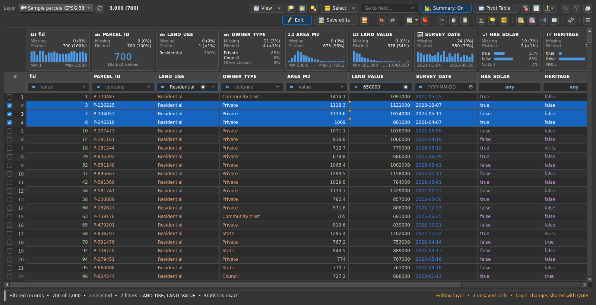

- Cells open the field's configured QGIS editor widget (double-click, F2 or
  typing; a click only frames the cell). Hard constraints keep the value
  in the editor with the reason, soft ones warn. Virtual, joined and read-only
  fields are locked. Unsaved cells get an amber corner.
- **Save edits** / *Ctrl+S* saves every unsaved change of the layer and keeps
  editing on (a failed save keeps the edits and shows the provider's message);
  **Discard**, **Undo** / **Redo** use the layer's own buffer and undo stack.
- **Add** (table or form), **Delete** (tells you how many selected features
  are hidden), **Cut / Copy / Paste** through the QGIS feature clipboard.
- **Field calculator** opens QGIS's own Field Calculator for the layer, as
  the native attribute table does (update a field or the geometry, new or
  virtual field; whole layer or only the selected features; it starts editing
  when needed).
- **Quick update** opens when editing starts, as the native table's field
  calculation bar does (Settings › *Show Quick update when editing starts*;
  its button still hides it). It is that bar: field +
  expression, then **Update All** (**Update Filtered** while the table is
  filtered) and **Update Selected** (every selected feature), plus an optional
  **Preview**. Values are calculated and stored as QGIS does it
  (`$area` / `$length` on the project's ellipsoid, `@row_number`, rounding to
  the field precision, unconvertible values become NULL).
- What can be edited is what the layer provides: with the map filter (query)
  off every record, also the ones the table filters hide; with the map filter
  on only the records the map shows.
- **Multi edit** with the layer's form. Field calculator, Quick update and
  Multi edit are each one undo step.
- **New field**, **Delete field**, **Reload**, and the ☰ menu: feature form,
  layer actions, copy rows as text, copy cell, set NULL, review unsaved
  changes, *Layer Properties…* (QGIS's own), native attribute table.
- **Field properties** (beside *Join table*; also *Field Properties…* when
  right-clicking a column name) shows every field in one grid, like QGIS's
  Fields tab and ArcGIS Pro's Fields view: change *Visible*, *Read only*, the
  *Field name*, *Alias*, *Allow NULL*, *Unique* and the *Default value* (also
  *On update*); type, length, precision, origin and comment are shown. A
  filter box narrows the rows, changed rows show their name in bold, and *OK*
  applies everything together (a rename is in the edit session, like *Rename
  Field*; the rest is saved in the project). *Layer Properties…* opens QGIS's
  Fields page.

  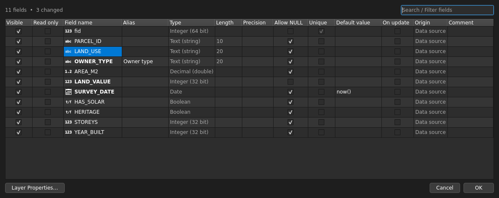
- **Join table** (beside *New field*, no editing needed) adds a QGIS layer
  join, as *Layer Properties › Joins* does. Choose the *Join layer* in the
  box (or drop a CSV, Excel, GeoPackage or shapefile on the window from your
  file manager); under *Field match* the two fields are proposed and the
  window counts the records that will match before you join (values match as
  text, NULL never matches, a repeated join value gives the last matching
  row). Tick the fields to add (none at first; a filter box narrows the list,
  *All* / *None* tick the fields shown); the names get QGIS's default prefix unless
  *Custom field name prefix* is ticked, as in QGIS's own window. Names the
  layer already has are flagged, since QGIS leaves them out. *Joins on this
  layer* lists the joins with Remove.

  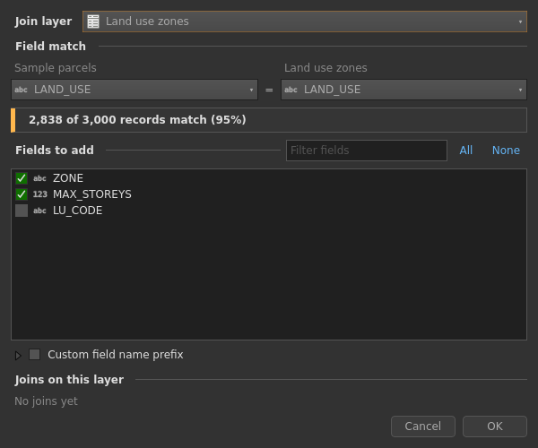
- **Advanced Filter (Expression)** is edited in place, as in QGIS's attribute
  table: a bar on the left of the edit row with QGIS's expression box —
  *Enter* or *Apply* applies, an invalid expression says why, *Escape* puts
  the applied one back, … opens the Expression Builder, ☆ saves or loads the
  layer's stored filter expressions and × removes the filter. In a narrow
  window the edit row moves its less used commands into *More* to keep room.
- The status bar's line says what the table and its statistics show (scope,
  records shown of those available, selection, filters — listed on hover).
- The right of the status bar shows the session state and the unsaved counts
  (orange while editing, red when a save failed); disabled buttons say why in
  their tooltip.
- Closing with unsaved edits asks *Save and close* / *Close and keep layer
  edits* / *Cancel*; stopping asks *Save* / *Discard* / *Cancel*.
- While editing, the **map filter is frozen**: the table works on exactly the
  records the map shows, and the map filter can be changed or turned off again
  after editing stops.
- Optional (*Settings*): **F6**, **Shift+F6** and **Ctrl+F6** open the explorer
  for all, selected or map-visible records instead of the native attribute
  table; turning the option off gives the keys back.

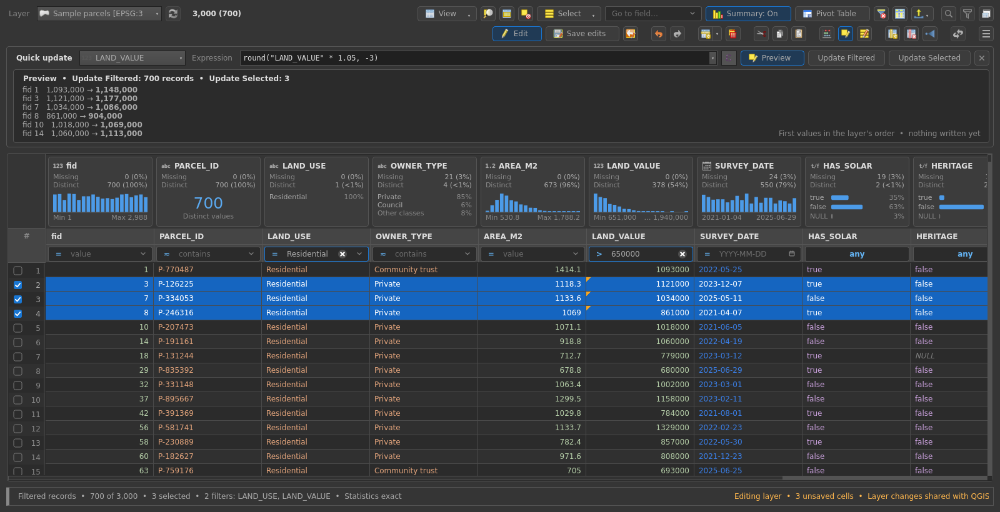

Form view (*View ▾ › Form View*) shows the layer's configured form next to a
record list labelled with the layer's display expression:

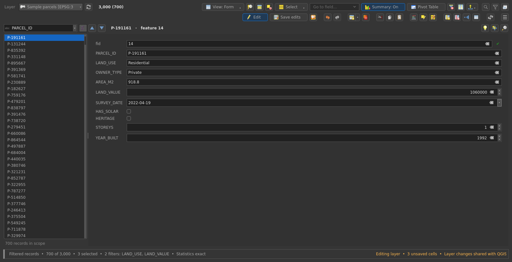

Statistics are exact and calculated in background tasks (visible columns
first, cancellable). Large layers show their records immediately and fill in
the profiles afterwards; stale results are never shown.

## Pivot Table

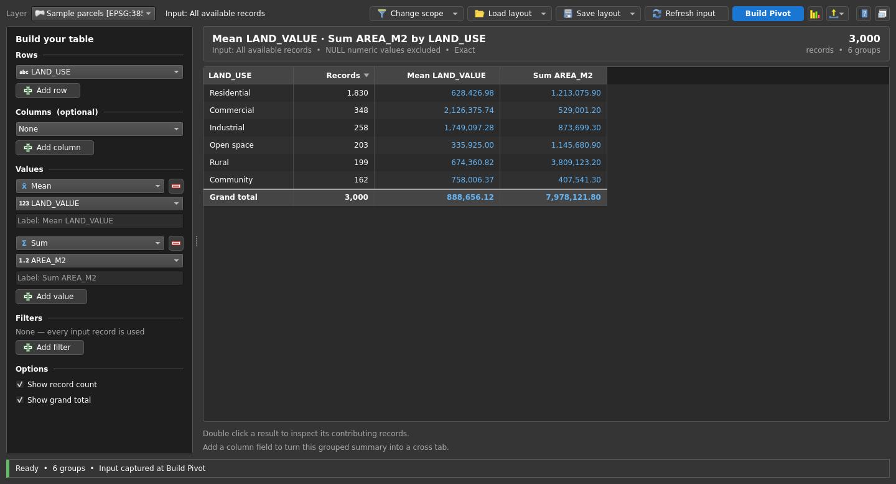

- Input scope: all available records, Explorer filtered records or selected
  records; the ids are captured, later changes mark the result stale
  (*Refresh input*, then *Build Pivot*).
- Rows (one or more), optional columns (cross tab), several values with
  optional labels. Each value is an operator (with its symbol; hover for
  what it does), then the field it reads: # count records, n count non-NULL,
  ≠ count distinct, ≡ list distinct (the different values as text, A to Z —
  e.g. the inlet types of every pit), Σ sum, x̄ mean, x̃ median, ↓ min,
  ↑ max, σ population standard deviation.
- *Add filter* opens a small dialog; each filter then shows as a chip
  (click to edit, × to remove). All filters must match (AND).
- Totals are calculated from contributing records (never by averaging group
  results); NULL groups are separate from the text "NULL"; missing cross-tab
  cells show NULL (Count records: 0).
- Double-click a result to open its records in Attribute Explorer.
- **Chart** (the chart icon next to *Build Pivot*): the built pivot as a chart
  in the Visualize Statistics window — one bar per row, its value one of the
  pivot's values (column or bar chart). With a column field the pivot's
  columns become the colours, stacked (counts and sums, which add up) or side
  by side; beyond 8 columns the rest form an exact *Other*. Hover for the
  numbers, click a bar to select its records (Ctrl+click adds, drag for a
  range), right-click to inspect them in Attribute Explorer. It sorts as the
  table or by value, draws negative values below the 0 line, follows every
  new build and exports as PNG, SVG or CSV.

  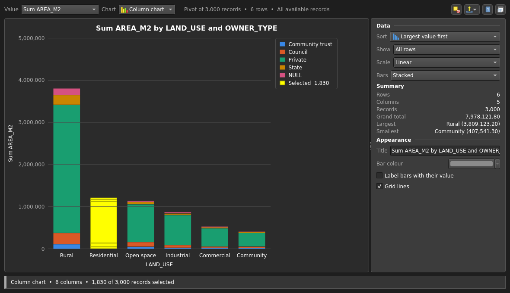
- Save / load layouts (recipes only) in the project or a JSON file; export to
  Excel, CSV or a non-spatial GeoPackage table with the layout and scope.

## Data Plot

Plots of a layer's records, with the twelve chart types of ArcGIS Pro and the
options it gives each. Open it from the **Data Plot** button of the toolbar
(after Pivot Table), the plugin menu, or Attribute Explorer's **Data Plot**
button: its menu lists the plot types, and the plot opens with the
Explorer's filtered records. Data Plot is separate from Visualize Statistics
(one column of an Attribute Explorer) and from the Pivot Table chart.

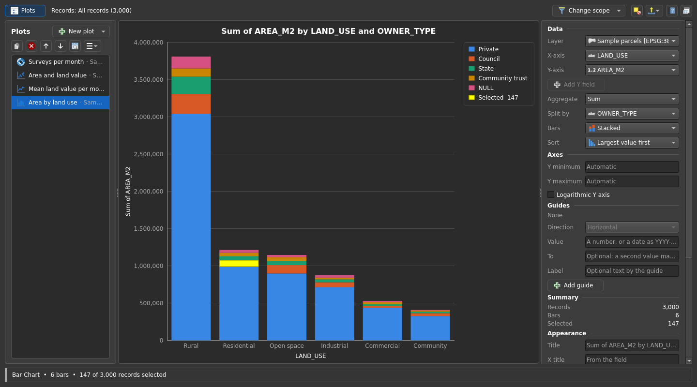

- **Records**: all records, the Attribute Explorer's filtered records,
  selected records or the visible map extent (*Change scope*). The plot
  follows them live: a new filter, selection, map extent or edit draws it
  again. Big layers are read in the background (progress and Cancel in the
  status bar) and only the fields a plot uses are kept.
- **Plots**: every layer keeps a list of plots, saved in the QGIS project.
  New plot and the list's buttons sit above the list: rename, duplicate,
  delete, move, *Open in new window* (two plots side by side), *Save plot to
  file* and *Load plot from file*. The **Plots** button at the top left hides
  the list for a wider plot and shows it again; every window opens with the
  list shown.

  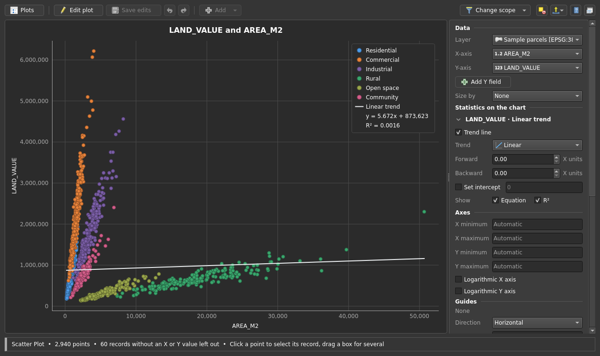
- **Settings** in one card, as in Visualize Statistics: *Data* (an
  **X-axis** and a **Y-axis** box wherever the type has both), *Time
  binning* (dates in intervals of a chosen size, aligned to the first or
  last record or a reference time, incomplete intervals trimmed),
  *Statistics on the chart*, *Axes* (bounds, logarithmic axes), *Guides*
  (lines or ranges at a value, with a label), *Summary* and *Appearance*
  (titles, description, colours, legend).
- **Selection both ways**: click a point, bar, slice, box, bin or cell to
  select its records (Ctrl+click adds; drag for a box or a range); records
  selected on the map or in Attribute Explorer show in the plot in the
  selection colour. Right-click for *Inspect in Attribute Explorer*.
- **Plot types**:
  - *Bar Chart*, *Line Chart*: Count of records or the sum, mean, median,
    minimum or maximum of one or more fields per category, interval or
    value; Split by a field; bars side by side, stacked or 100% stacked;
    empty intervals as zero, connected or broken.
  - *Combo Chart*: bar and line series on a left and a right axis.
  - *Pie Chart*: the categories of a field or several number fields;
    grouping threshold (an exact Other) and donut hole.
  - *Histogram*: bins (the square root of the records by default), mean,
    median and standard deviation lines, normal curve, logarithmic and square
    root transformations, small histograms per category with a preview.
  - *Box Plot*: quartiles, whiskers and outliers (1.5 × the interquartile
    range) of one or more fields per category, z-scores for several fields.
  - *Scatter Plot*: Size by, the layer's symbology colours, linear,
    exponential, logarithmic, power and polynomial trend lines with R².
  - *Scatter Plot Matrix*: every pair of several fields, R² values, a
    preview plot, histograms on the diagonal.
  - *QQ Plot*: a field against the normal distribution or a second field,
    with a reference line and five transformations (SciPy when QGIS has it).
  - *Matrix Heat Chart*, *Calendar Heat Chart*, *Data Clock*: cells
    coloured by class (equal interval, geometric interval, natural breaks or
    quantile) in any QGIS colour ramp.
- **Export**: PNG or SVG image, copy the image, or the plotted values as CSV.
- **Big layers**: a scatter plot draws every point up to 100,000 points and
  shades each spot by its records above that (5 million points take about
  0.3 s). In tests on a made-up table of 1 million records each plot was
  ready in 3 to 5 s; with 10 million in 37 to 68 s, and QGIS never paused
  for more than 0.13 s meanwhile.

## Geometry and Table Compare

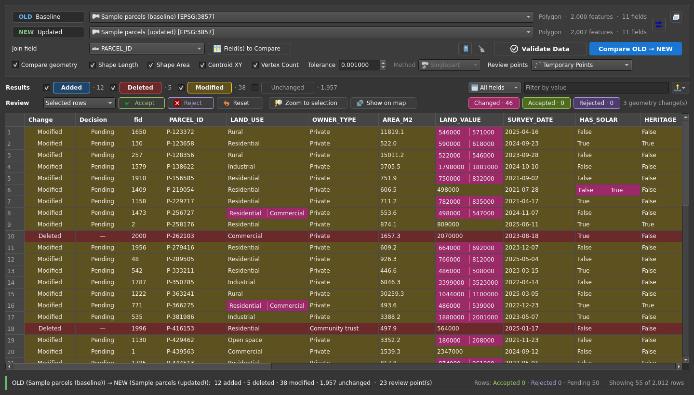

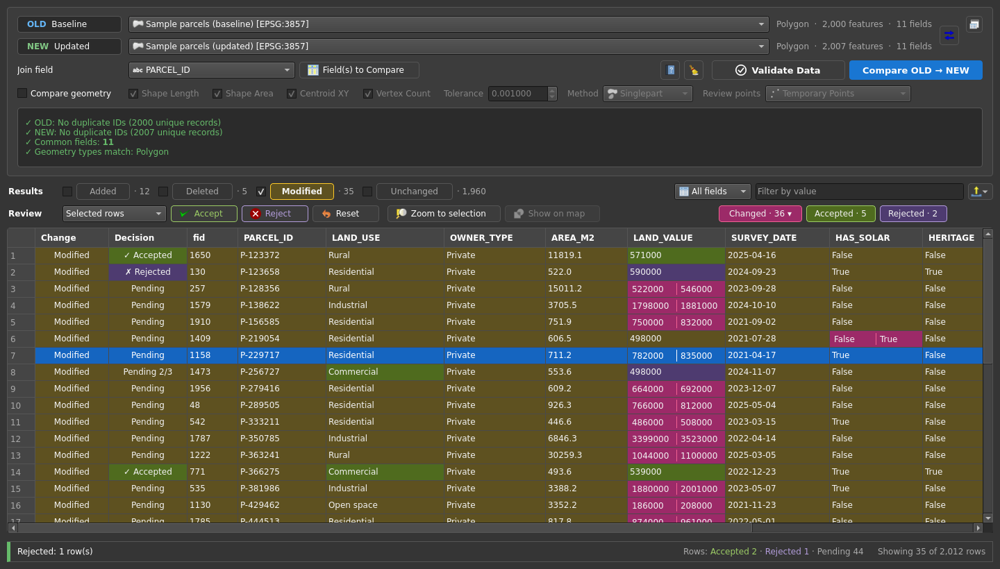

A change-tracking tool: an OLD baseline and a NEW update of the same dataset
are matched by a unique ID and every feature is reported as Added, Deleted,
Modified or Unchanged. The comparison engine is unchanged from the standalone
plugin v1.1 (the regression test checks that exports match it byte for byte).

- A **changed value** shows OLD and NEW side by side, split by a divider.
  Right-click values to **accept** (keeps NEW, lime *Accepted*),
  **reject** (keeps OLD, lavender *Rejected*) or reset them, one cell or
  many at once; the cell then shows the one value kept.
- *Accept / Reject / Reset* (buttons or right-click) decide every changed
  value of whole rows. The Decision column follows the values: Accepted,
  Rejected, Mixed or *Pending 1/3*. Exports keep OLD for rejected values and
  NEW otherwise.
- **Which fields changed?** The *Changed* chip of the Review row opens the
  changed fields: one line per field, most changes first, with the modified
  records it changed in, their share and a small bar (accepted, rejected and
  pending on hover). Click a field to show only the records where it changed
  (the table scrolls to its column); *All* shows every change again.

  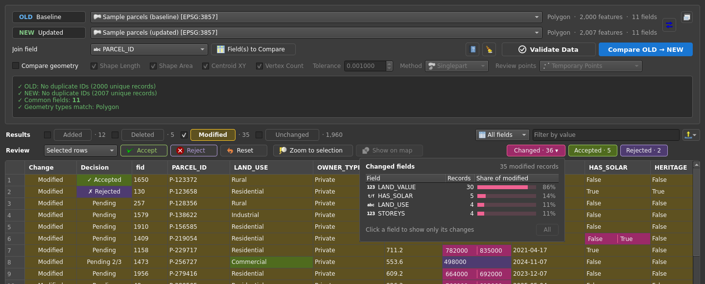
- **Export ▾ › GeoPackage — features** writes the features of the rows shown
  to one GeoPackage, one layer per kind (added, deleted, modified, unchanged),
  and adds them to the map as a group named after the file. Every layer has
  the same fields: `CHANGE`, `DECISION`, `CHANGED_FIELDS`, then the table's
  columns holding the reviewed value (NEW, or OLD where the change was
  rejected); a column that changed also gets `<name>_OLD` with the OLD value.
  Numbers and dates keep their types. The shape is NEW, or OLD for deleted
  features and rejected shape changes, in the NEW layer's CRS.
- **Zoom to selection** (button or right-click) selects the rows' features in
  the OLD and NEW layers, zooms to them and flashes them.
- The help button explains the tool; the broom button clears the validation
  results. The v1.1 *Validate Data* and *Compare OLD → NEW* buttons, Results
  legend and bottom bar with its progress bar are kept.

## Look and sizes

All three tools share one palette, native QGIS icons (16 px) and one size
ladder: inputs, buttons and square icon buttons are 24 px, including the blue
*Build Pivot*; Compare's *Validate Data* and *Compare OLD → NEW* (190 × 28,
as in v1.1) and *Swap* are 28 px. When a window is too narrow for the button
labels, the buttons turn icon-only together and keep their 16 px icons.
The status bar sits fully inside every window.

Attribute Explorer colours values by type: text orange, numbers green, dates
blue (one blue that reads on light and dark themes), booleans purple, NULL
grey.

## Project layout

```
plugin.py              toolbar, menu, shortcuts, layer menu, window registry
core/                  UI-free engines (pure Python where possible)
  fields.py            field kinds, NULL handling, formatting
  stats.py             column profiles
  filters.py           column filters → QGIS expressions
  pivot.py             pivot engine; pivot_chart.py its chart's bars
  plots.py             Data Plot: compact reading, binning, aggregation, trends,
                       quartiles, classes, the numbers of all twelve plot types
  scan.py              background feature scans (geometry only when needed)
  charts.py            Visualize Statistics: compact columns, bins, periods
  constraints.py       field constraint checks (failing records scope)
  subset.py            map filter (table filters → layer subset)
  jobs.py              QgsTask wrapper with stale-result protection
  export.py            CSV / Excel writers with scope records
  compare_export.py    Compare's GeoPackage of the features (one layer per kind)
ui/
  theme.py             shared palette, metrics and style sheet
  widgets.py           uniform buttons, status strip, field dialogs
  icons.py             native QGIS icons + tool icons
  tool_host.py         window ↔ dock host
  attribute_explorer.py, explorer_header.py, explorer_table.py
  explorer_edit.py     edit session controller (save / discard / prompts)
  explorer_editing.py  edit row commands; explorer_bars.py edit and Quick update rows
  explorer_join.py     Join table window (core/joins.py: matching rules, counts)
  explorer_chart.py    Visualize Statistics window; chart_view.py draws the chart
  explorer_browse.py   View / Select menus, scopes, expression filters
  explorer_ops.py, explorer_dialogs.py, explorer_form.py
                       calculator, field and form dialogs, form view
  pivot_table.py       Pivot Table window; pivot_chart.py its chart window
  data_plot.py         Data Plot window, plot list, settings card; plot_view.py draws
  geotable_compare.py
  settings_dialog.py
  help_dialog.py       Help window of each tool; help_pages.py its tabs and numbered items
icons/                 toolbar icons; icons/plots/ the plot type icons
help/                  pictures of the Help tabs (made by tests/qgis/make_help_images.py)
tests/                 unit tests + headless QGIS tests
```

## Tests

```
python -m unittest discover -s tests          # engines, no QGIS needed
# with QGIS' Python (QT_QPA_PLATFORM=offscreen for headless):
python tests/qgis/test_filters_qgis.py        # expressions on memory + GeoPackage layers
python tests/qgis/test_suite_qgis.py          # end-to-end: the tools together
python tests/qgis/test_data_plot_qgis.py      # Data Plot: every type's numbers, selection, saving
python tests/qgis/test_compare_regression.py  # Compare exports == v1.1
python tests/qgis/test_editing_qgis.py        # Explorer editing, forms, scopes, menus
python tests/qgis/make_screenshots.py docs/screenshots dark   # README images (made-up data)
python tests/qgis/make_screenshots.py docs/screenshots light
python tests/qgis/make_help_images.py         # Help pictures in help/ (made-up data)
```

All suites pass on QGIS 4.4 (Qt 6.11) and QGIS 3.44 LTR (Qt 5.15).

## Acknowledgements

Special thanks to **Data Wrangler**, Microsoft's data viewing and cleaning
extension for Visual Studio Code and VS Code Jupyter notebooks, which
inspired this plugin and the idea of bringing that way of exploring a table
to QGIS. Its *Quick Insights* header (each column's distribution or value
frequencies, with missing and distinct counts, right above the data grid),
its *Data Summary* panel and the filters and sorts in every column header
are the model for Attribute Explorer's statistics cards, column filters and
statistics popup, here working on map layers with their selection, editing
and Query Builder filters.

- Visual Studio Marketplace: [Data Wrangler (ms-toolsai.datawrangler)](https://marketplace.visualstudio.com/items?itemName=ms-toolsai.datawrangler)
- Documentation: [Data Wrangler in VS Code](https://code.visualstudio.com/docs/datascience/data-wrangler)
- Repository: [microsoft/vscode-data-wrangler](https://github.com/microsoft/vscode-data-wrangler)

Attribute Table Studio is an independent project: it is not affiliated with or
endorsed by Microsoft and shares no code with Data Wrangler. Visual Studio
Code is a trademark of Microsoft Corporation.

## License

GNU General Public License version 3 with an attribution term under section
7(b) — see [LICENSE](LICENSE) and [ADDITIONAL_TERMS.md](ADDITIONAL_TERMS.md).

You may use, study, share and change Attribute Table Studio. If you distribute
it, or a work based on it, that work stays under the GPL v3 with its source
code, keeps the copyright notices in the source files, and shows this
attribution wherever it lists its legal notices (for example an About or Help
screen):

    Based on Attribute Table Studio by Irene Jaya
    https://github.com/irenejaya/attribute-table-studio
