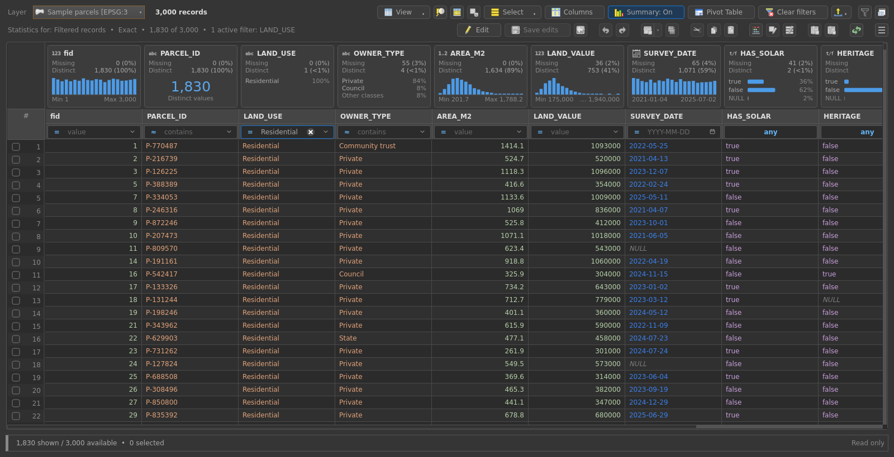
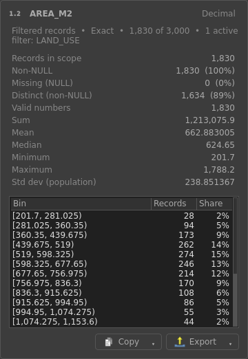
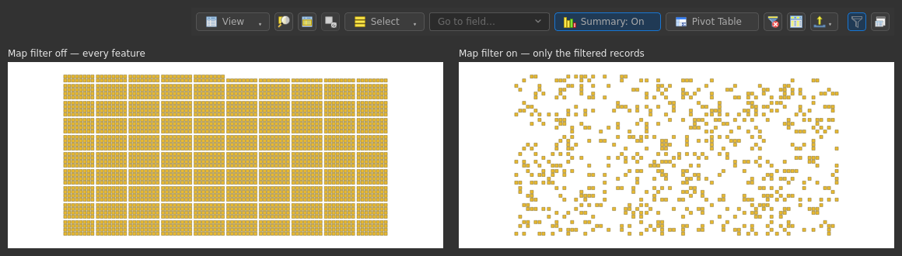
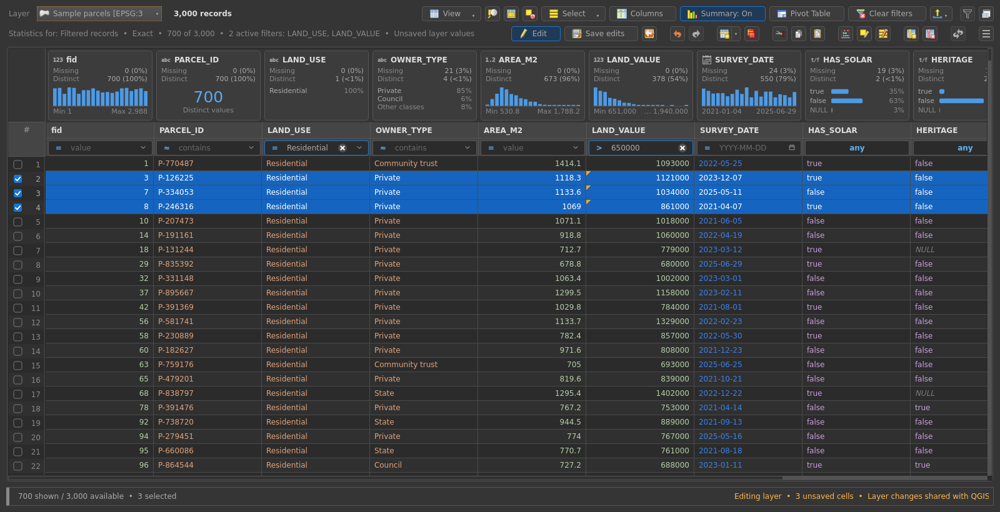
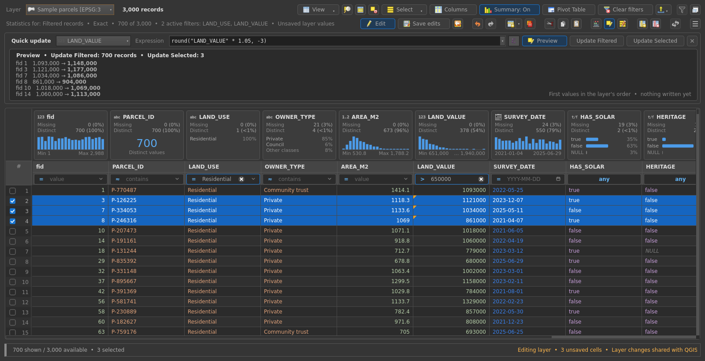
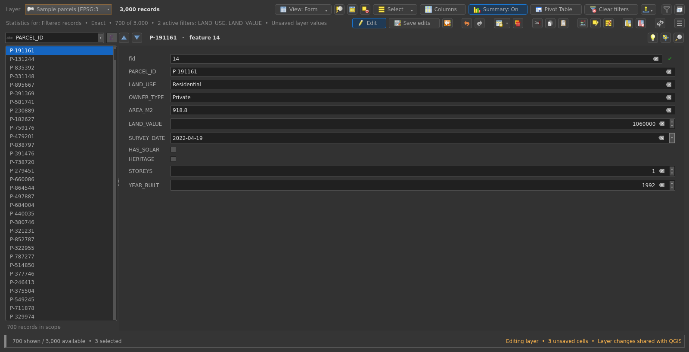
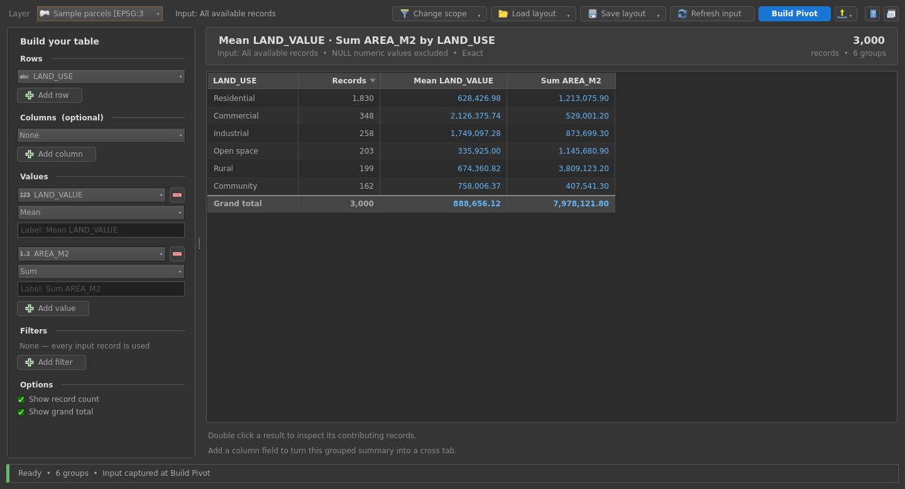
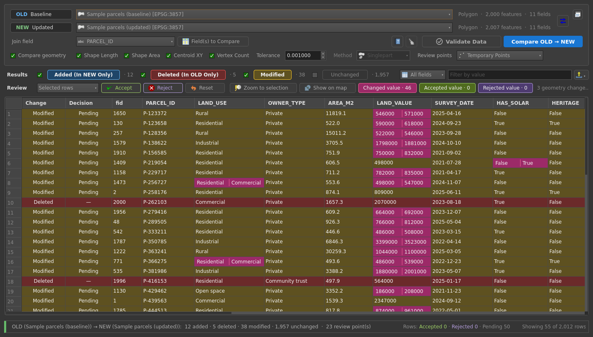
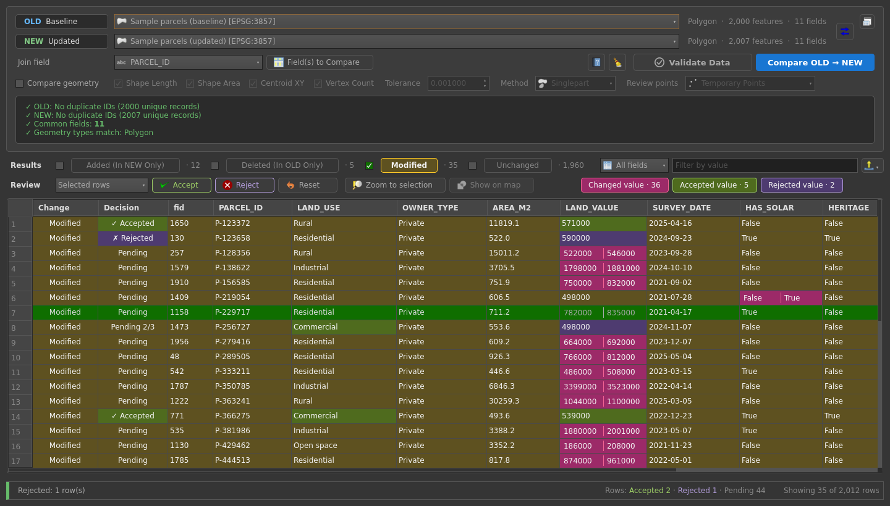

# Attribute Table Studio

One QGIS plugin, one toolbar, three tools for working with attribute tables:

| | Tool | What it does |
|---|---|---|
|  | **Attribute Explorer** | A fast attribute table with exact statistics attached above every column, a typed filter under every heading and a full editing mode. |
|  | **Pivot Table** | Grouped summaries and cross tabs with correct totals, an explicit input scope and drill-through to the contributing records. |
|  | **Geometry and Table Compare** | OLD → NEW comparison of two dataset versions: added, deleted, modified and unchanged features, field-level changes, geometry review points. |

Supports **QGIS 3.40 LTR+ (Qt5) and QGIS 4.x (Qt6)**, light and dark themes.

Inspired by Microsoft's [Data Wrangler](https://marketplace.visualstudio.com/items?itemName=ms-toolsai.datawrangler)
extension for Visual Studio Code — see [Acknowledgements](#acknowledgements).



## Install

1. Build the zip: `python scripts/package.py` → `dist/attribute_table_studio-1.0.zip`
2. QGIS → *Plugins › Manage and Install Plugins › Install from ZIP*.
3. If the standalone *Geometry and Table Compare* plugin is installed, disable
   it — Attribute Table Studio includes it (the plugin warns when both are enabled).

## Windows and docking

Every tool opens in **its own window** (own taskbar entry) that remembers its
size and position. The **Dock** button at the top right of each tool docks it
into the QGIS main window — and undocks it again — keeping filters, results
and selections. *Plugins › Attribute Table Studio › Settings* can open each tool
docked by default, like *Open attribute table as docked window* in QGIS.

## Attribute Explorer

Open it from the toolbar, the plugin menu, a vector layer's right-click menu
(*Open in Attribute Explorer*) or the keyboard shortcut (**Ctrl+Alt+T** is
proposed and only assigned when no other command uses it; change it in
*Settings › Keyboard Shortcuts*). Each layer gets its own explorer.

- **Column profiles** above every column: missing (NULL) and distinct counts,
  top categories with shares of non-NULL values, histograms with min / max,
  earliest / latest dates, true / false counts. Hover a bar for its count,
  the rest of the card for a brief summary. Click a profile for full
  statistics (sum, mean, median, population standard deviation, searchable
  frequency list, blank and whitespace values, histogram bins); both tables
  are selectable (Ctrl+C), and **Copy ▾** / **Export ▾** copy or save the
  summary, the distribution or everything (Excel workbook with Summary and
  Distribution sheets, or CSV; shares as numbers, scope recorded).

  
- **Filters** under every heading — text: contains, equals, starts with, is
  one of, is NULL, is not NULL; numbers: =, ≠, <, ≤, >, ≥, between, is one of;
  dates: on, before, after, between (calendar, YYYY-MM-DD hints); booleans:
  true, false, NULL.
  Columns combine with AND, values within a column with OR. Invalid input is
  outlined red and the last valid result stays. The ✕ in a filter box clears
  it (also for *is one of*); the value list sorts by value or by records.
- **Scope rules**: profiles describe exactly the filtered records (not just
  the visible screen). NULL is missing; zero and empty text are values.
  Sorting and hiding columns never change the population.
- **Selection** stays in sync with the map (click, Ctrl, Shift, drag or the
  tick boxes — a tick click selects only that row, Ctrl adds, Shift extends,
  also while editing). A feature selected on the map scrolls its row into view.
  *Selected only* limits table and statistics to the selection. Filtering
  never changes the map selection.
- **Map filter** (the outline funnel next to *Dock*, the mark QGIS shows beside
  a filtered layer): a quick, temporary filter of the map. While it is on, the
  map shows only the records of the table filters and follows them as they
  change. It is written as readable SQL where the layer's format answers
  exactly like the table (otherwise as a list of feature ids), on top of any
  Query Builder filter the layer already has. Turning it off, closing the
  explorer or switching it to another layer shows every feature again and
  gives the layer exactly its own filter back; the table keeps its filters
  until *Clear filters*. A project saved meanwhile keeps only the layer's own
  filter, and a Query Builder change made while it is on wins (the map filter
  goes off). It is frozen while the layer is being edited, since QGIS allows
  no filter changes then; an explorer closed during editing gives the filter
  back as soon as editing stops.

  
- Sort by clicking a column name, drag to reorder, *Columns* to show / hide /
  reorder; layouts are saved with the layer in the project.
- The top row, right aligned: *View ▾*, *Zoom to selection*, *Selected only*
  and *Deselect features from the current layer* (icons), *Select ▾*,
  *Columns*, *Summary*, *Pivot Table*, *Clear filters*, *Export ▾* (icon), the
  map filter and *Dock*.
- *Export ▾* to Excel or CSV with the scope recorded, or copy the selected
  rows (*Ctrl+C*); *Pivot Table* hands the filtered records to the Pivot
  Table.
- Menus are written the way QGIS writes them (Title Case; "…" when the entry
  opens a dialog).
- **View ▾** (before *Columns*): *Table View* or *Form View*; the scopes with
  the names and icons of the QGIS attribute table (*Show All Features*, *Show
  Selected Features*, *Show Features Visible on Map*, *Show Features with
  Failing Constraints*, *Show Edited and New Features*); *Advanced Filter
  (Expression)…* (replace / AND / OR), *Stored Filter Expressions…*, *Filter
  by Form…*, *Case-Sensitive Text Filters*, *Move Selection to Top*, *Sort by
  Expression…*, *Conditional Formatting…*, *Autosize All Columns*. Column
  filters always apply on top of the scope.
- **Select ▾**: *Select All Features*, *Invert Selection* (each also for the
  *Whole Layer* while the table is filtered), *Deselect Features from All
  Layers*, *Select Features by Expression…*, *Select Features by Value…*,
  *Pan to Selection*, *Zoom to Selection*.

### Editing

The explorer opens read-only. **Edit** on the second row (the *Statistics
for* line is on its left) starts the layer's own edit session — shared with the map, the native
attribute table and every other QGIS tool.



- Cells open the field's configured QGIS editor widget (double-click, F2 or
  typing; a click only focuses while editing). Hard constraints keep the value
  in the editor with the reason, soft ones warn. Virtual, joined and read-only
  fields are locked. Unsaved cells get an amber corner.
- **Save edits** / *Ctrl+S* saves every unsaved change of the layer and keeps
  editing on (a failed save keeps the edits and shows the provider's message);
  **Discard**, **Undo** / **Redo** use the layer's own buffer and undo stack.
- **Add** (table or form), **Delete** (tells you how many selected features
  are hidden), **Cut / Copy / Paste** through the QGIS feature clipboard.
- **Field calculator** opens QGIS's own Field Calculator for the layer, as
  the native attribute table does (update a field or the geometry, new or
  virtual field; whole layer or only the selected features; it starts editing
  when needed).
- **Quick update** is the native table's field calculation bar: field +
  expression, then **Update All** (**Update Filtered** while the table is
  filtered) and **Update Selected** (every selected feature), plus an optional
  **Preview**. Values are calculated and stored as QGIS does it
  (`$area` / `$length` on the project's ellipsoid, `@row_number`, rounding to
  the field precision, unconvertible values become NULL).
- What can be edited is what the layer provides: with the map filter (query)
  off every record, also the ones the table filters hide; with the map filter
  on only the records the map shows.
- **Multi edit** with the layer's form. Field calculator, Quick update and
  Multi edit are each one undo step.
- **New field**, **Delete field**, **Reload**, and the ☰ menu: feature form,
  layer actions, copy rows as text, copy cell, set NULL, review unsaved
  changes, field properties, native attribute table.
- The right of the status bar shows the session state and the unsaved counts
  (orange while editing, red when a save failed); disabled buttons say why in
  their tooltip.
- Closing with unsaved edits asks *Save and close* / *Close and keep layer
  edits* / *Cancel*; stopping asks *Save* / *Discard* / *Cancel*.
- While editing, the **map filter is frozen**: the table works on exactly the
  records the map shows, and the map filter can be changed or turned off again
  after editing stops.
- Optional (*Settings*): **F6**, **Shift+F6** and **Ctrl+F6** open the explorer
  for all, selected or map-visible records instead of the native attribute
  table; turning the option off gives the keys back.



Form view (*View ▾ › Form View*) shows the layer's configured form next to a
record list labelled with the layer's display expression:



Statistics are exact and calculated in background tasks (visible columns
first, cancellable). Large layers show their records immediately and fill in
the profiles afterwards; stale results are never shown.

## Pivot Table



- Input scope: all available records, Explorer filtered records or selected
  records; the ids are captured, later changes mark the result stale
  (*Refresh input*, then *Build Pivot*).
- Rows (one or more), optional columns (cross tab), several values — count
  records, count non-NULL, count distinct, sum, mean, median, min, max,
  population standard deviation — with optional labels.
- *Add filter* opens a small dialog; each filter then shows as a chip
  (click to edit, × to remove). All filters must match (AND).
- Totals are calculated from contributing records (never by averaging group
  results); NULL groups are separate from the text "NULL"; missing cross-tab
  cells show NULL (Count records: 0).
- Double-click a result to open its records in Attribute Explorer.
- Save / load layouts (recipes only) in the project or a JSON file; export to
  Excel, CSV or a non-spatial GeoPackage table with the layout and scope.

## Geometry and Table Compare





A change-tracking tool: an OLD baseline and a NEW update of the same dataset
are matched by a unique ID and every feature is reported as Added, Deleted,
Modified or Unchanged. The comparison engine is unchanged from the standalone
plugin v1.1 (the regression test checks that exports match it byte for byte).

- A **changed value** shows OLD and NEW side by side, split by a divider.
  Right-click values to **accept** (keeps NEW, lime *Accepted value*),
  **reject** (keeps OLD, lavender *Rejected value*) or reset them, one cell or
  many at once; the cell then shows the one value kept.
- *Accept / Reject / Reset* (buttons or right-click) decide every changed
  value of whole rows. The Decision column follows the values: Accepted,
  Rejected, Mixed or *Pending 1/3*. Exports keep OLD for rejected values and
  NEW otherwise.
- **Zoom to selection** (button or right-click) selects the rows' features in
  the OLD and NEW layers, zooms to them and flashes them.
- The help button explains the tool; the broom button clears the validation
  results. The v1.1 *Validate Data* and *Compare OLD → NEW* buttons, Results
  legend and bottom bar with its progress bar are kept.

## Look and sizes

All three tools share one palette, native QGIS icons (16 px) and one size
ladder: inputs, buttons and square icon buttons are 24 px, including the blue
*Build Pivot*; Compare's *Validate Data* and *Compare OLD → NEW* (190 × 28,
as in v1.1) and *Swap* are 28 px. When a window is too narrow for the button
labels, the buttons turn icon-only together and keep their 16 px icons.
The status bar sits fully inside every window.

Attribute Explorer colours values by type: text orange, numbers green, dates
blue (one blue that reads on light and dark themes), booleans purple, NULL
grey.

## Project layout

```
plugin.py              toolbar, menu, shortcuts, layer menu, window registry
core/                  UI-free engines (pure Python where possible)
  fields.py            field kinds, NULL handling, formatting
  stats.py             column profiles
  filters.py           column filters → QGIS expressions
  pivot.py             pivot engine
  scan.py              background feature scans (geometry only when needed)
  constraints.py       field constraint checks (failing records scope)
  subset.py            map filter (table filters → layer subset)
  jobs.py              QgsTask wrapper with stale-result protection
  export.py            CSV / Excel writers with scope records
ui/
  theme.py             shared palette, metrics and style sheet
  widgets.py           uniform buttons, status strip, field dialogs
  icons.py             native QGIS icons + tool icons
  tool_host.py         window ↔ dock host
  attribute_explorer.py, explorer_header.py, explorer_table.py
  explorer_edit.py     edit session controller (save / discard / prompts)
  explorer_editing.py  edit row commands; explorer_bars.py edit and Quick update rows
  explorer_browse.py   View / Select menus, scopes, expression filters
  explorer_ops.py, explorer_dialogs.py, explorer_form.py
                       calculator, field and form dialogs, form view
  pivot_table.py
  geotable_compare.py
  settings_dialog.py, help_dialog.py
icons/                 toolbar icons
tests/                 unit tests + headless QGIS tests
```

## Tests

```
python -m unittest discover -s tests          # engines, no QGIS needed
# with QGIS' Python (QT_QPA_PLATFORM=offscreen for headless):
python tests/qgis/test_filters_qgis.py        # expressions on memory + GeoPackage layers
python tests/qgis/test_suite_qgis.py          # end-to-end: all three tools
python tests/qgis/test_compare_regression.py  # Compare exports == v1.1
python tests/qgis/test_editing_qgis.py        # Explorer editing, forms, scopes, menus
python tests/qgis/make_screenshots.py docs/screenshots dark   # README images (made-up data)
python tests/qgis/make_screenshots.py docs/screenshots light
```

All suites pass on QGIS 4.2 (Qt 6.11) and QGIS 3.44 LTR (Qt 5.15).

## Acknowledgements

Special thanks to **Data Wrangler**, Microsoft's data viewing and cleaning
extension for Visual Studio Code and VS Code Jupyter notebooks, which
inspired this plugin and the idea of bringing that way of exploring a table
to QGIS. Its *Quick Insights* header (each column's distribution or value
frequencies, with missing and distinct counts, right above the data grid),
its *Data Summary* panel and the filters and sorts in every column header
are the model for Attribute Explorer's statistics cards, column filters and
statistics popup, here working on map layers with their selection, editing
and Query Builder filters.

- Visual Studio Marketplace: [Data Wrangler (ms-toolsai.datawrangler)](https://marketplace.visualstudio.com/items?itemName=ms-toolsai.datawrangler)
- Documentation: [Data Wrangler in VS Code](https://code.visualstudio.com/docs/datascience/data-wrangler)
- Repository: [microsoft/vscode-data-wrangler](https://github.com/microsoft/vscode-data-wrangler)

Attribute Table Studio is an independent project: it is not affiliated with or
endorsed by Microsoft and shares no code with Data Wrangler. Visual Studio
Code is a trademark of Microsoft Corporation.

## License

MIT — see [LICENSE](LICENSE).
