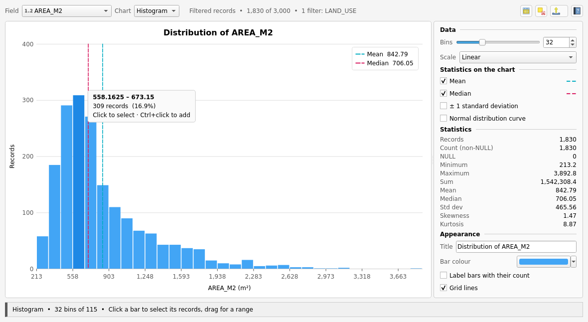
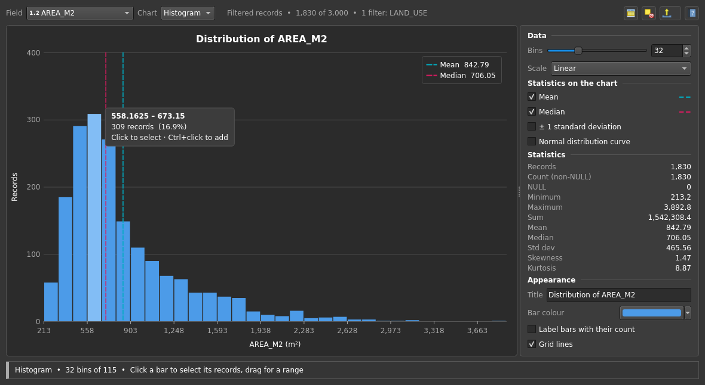
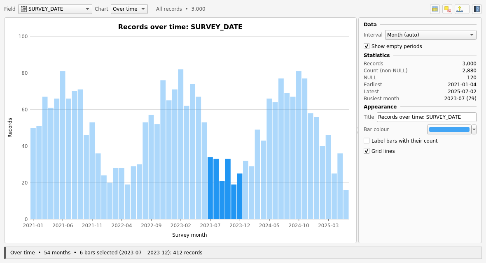
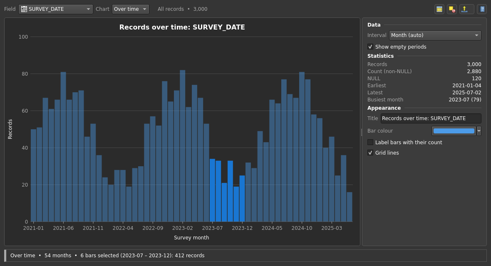
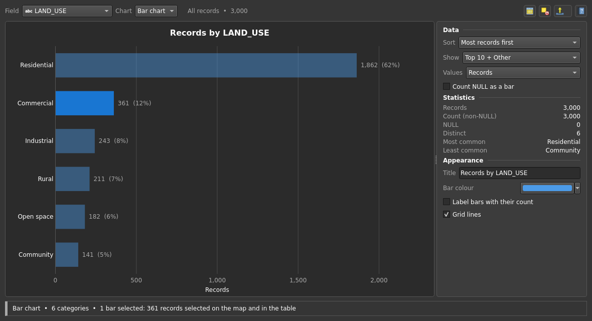

# Visualize Statistics (plan for dev-v2, not built yet)

A chart window for one column of the Attribute Explorer, in the spirit of
ArcGIS Pro's *Visualize Statistics*: the statistics the Explorer already
calculates, drawn as a full-size chart you can adjust and click.

The mock-ups below are real QGIS 4.2 renders (light: Fusion; dark: QGIS 4's
built-in dark look) of a prototype with made-up data. Wording, sizes and
colours are proposals.

## Where it opens

- Right-click a column name › **Visualize Statistics…**, next to the
  statistics entries.
- The statistics popup (click a profile card) gets a **Chart…** button.
- One chart window per Explorer; picking another field in its **Field** box
  switches the chart. It closes with its Explorer.

## The window

| Part | What it holds |
| --- | --- |
| Top row | **Field** (with its type icon), **Chart** (the chart kind for that field type), the scope line as in the Explorer's status bar (*Filtered records • 1,830 of 3,000 • 1 filter: LAND_USE*), then *Selected only*, *Clear the chart selection*, *Export ▾* and *Help* |
| Chart (left) | Title, axes, bars, statistic lines and a small legend |
| Settings (right, 300 px) | **Data** (bins, scale, interval or sort), **Statistics on the chart**, **Statistics** (the numbers), **Appearance** (title, bar colour, labels, grid lines) |
| Status bar | Chart kind, number of bins and the selection, as the other tools do |

### Number fields: histogram

- **Bins**: slider and box (4 to 100, default from the data); **Scale**:
  linear, logarithmic or square root.
- **Statistics on the chart**: mean (cyan dashed line), median (magenta
  dashed line), ± 1 standard deviation (shaded band) and a normal
  distribution curve; each ticks on or off and shows in the legend.
- **Statistics**: records, count, NULL, minimum, maximum, sum, mean, median,
  standard deviation (the Explorer's exact values), plus skewness and
  kurtosis (new).
- Hovering a bar shows its range, its records and their share.

### Date fields: over time

- **Interval**: chosen from the date range (Month here) or Day, Week,
  Quarter, Year; **Show empty periods** keeps gaps visible.
- **Statistics**: records, count, NULL, earliest, latest, busiest period.

### Text (and yes / no) fields: bar chart

- Horizontal bars so long values stay readable, each with its records and
  share.
- **Sort** (most records first, A → Z, Z → A), **Show** (top 10 + Other, top
  25 + Other, all values), **Values** (records or share), **Count NULL as a
  bar**.
- **Statistics**: records, count, NULL, distinct, most and least common.

## Chart, table and map work together

- **Click a bar** to select its records (on the map and in the Explorer,
  through the layer's selection); **Ctrl+click** adds a bar, **drag** across
  bars selects a range. Selected bars are drawn in the accent blue, the
  others fade (as in the date and bar chart mock-ups).
- **Clear the chart selection** deselects; **Selected only** charts only the
  selected records.
- The chart follows the Explorer: its filters, scope (Selected only, map
  extent…) and edits update it, calculated in the background like the
  statistics.

## Export

PNG and SVG image, copy the image, and the bins as CSV (with the scope
recorded, like the other exports).

## How it is drawn

With Qt itself (QPainter), like the Summary's histograms: no extra
packages, the same on QGIS 3.40+ and 4.x, light and dark from the QGIS
palette, bar colour from the Explorer's theme (changeable per chart).

## To decide

1. Extra chart kinds in the **Chart** box: a box plot for numbers, a pie or
   donut for categories, a line for dates.
2. **Split by** a second field (stacked or side-by-side bars), as ArcGIS
   offers.
3. Whether the window can be docked like the tools, or is always a window.
4. Whether chart settings (bins, colours, title) are remembered per field in
   the project.
5. Whether a double-click on a bar filters the Explorer to it (as *Filter to
   This Value* does), besides selecting.
