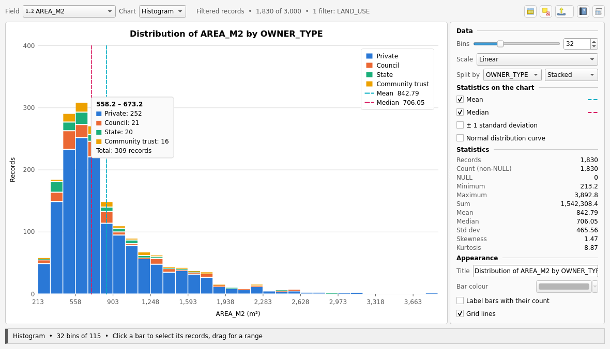
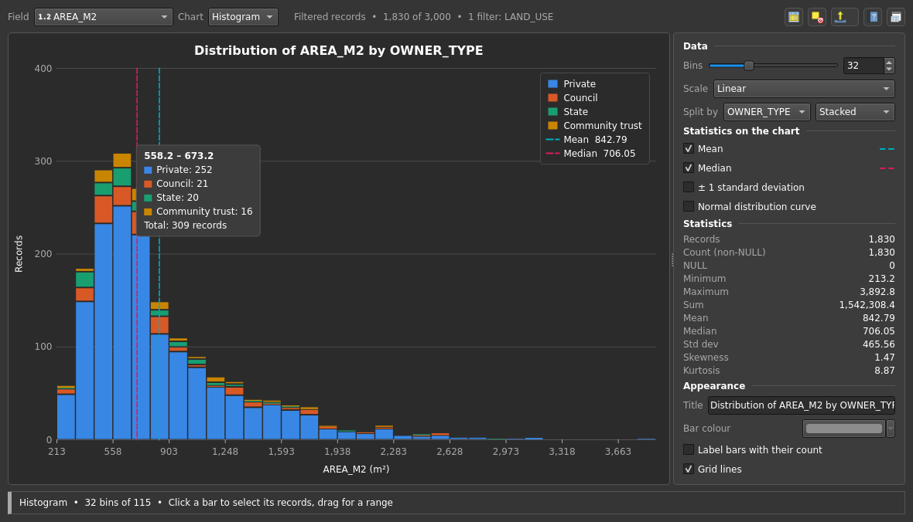
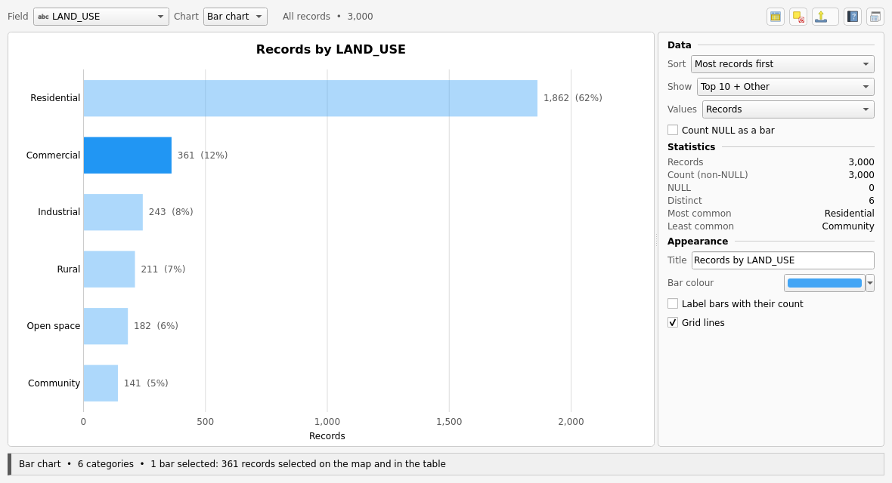

# Visualize Statistics (plan for dev-v2, not built yet)

A chart window for one column of the Attribute Explorer, in the spirit of
ArcGIS Pro's *Visualize Statistics*: the statistics the Explorer already
calculates, drawn as a full-size chart you can adjust and click.

The mock-ups below are real QGIS 4.2 renders (light: Fusion; dark: QGIS 4's
built-in dark look) of a prototype with made-up data. Wording, sizes and
colours are proposals.

## Decided

| Question | Decision |
| --- | --- |
| Layout | As in the mock-ups: top row, chart on the left, settings on the right, status bar |
| Chart kinds | One per field type for now: histogram (numbers), bar chart (text, yes / no), over time (dates) |
| Click on a bar | Selects its records (layer selection, so the map and the Explorer follow) |
| Window | Dockable, like the tools (**Dock** button at the top right) |
| Split by | A second field, as stacked or side-by-side bars, numbers and dates included |
| Drawing | Qt's own painter, no plotting library (see *Why not DataPlotly*) |

## Where it opens

- Right-click a column name › **Visualize Statistics…**, next to the
  statistics entries.
- The statistics popup (click a profile card) gets a **Chart…** button.
- One chart window per Explorer; picking another field in its **Field** box
  switches the chart. It closes with its Explorer.
- It opens as a window; **Dock** puts it in the QGIS dock area (and back),
  remembered for next time, as the tools do.

## The window

| Part | What it holds |
| --- | --- |
| Top row | **Field** (with its type icon), **Chart** (the chart kind for that field type), the scope line as in the Explorer's status bar (*Filtered records • 1,830 of 3,000 • 1 filter: LAND_USE*), then *Selected only*, *Clear the chart selection*, *Export ▾*, *Help* and *Dock* |
| Chart (left) | Title, axes, bars, statistic lines and a small legend |
| Settings (right, 300 px) | **Data** (bins, scale, interval or sort, **Split by**), **Statistics on the chart**, **Statistics** (the numbers), **Appearance** (title, bar colour, labels, grid lines) |
| Status bar | Chart kind, number of bins and the selection, as the other tools do |

### Number fields: histogram

- **Bins**: slider and box (4 to 100, default from the data); **Scale**:
  linear, logarithmic or square root.
- **Statistics on the chart**: mean (cyan dashed line), median (magenta
  dashed line), ± 1 standard deviation (shaded band) and a normal
  distribution curve; each ticks on or off and shows in the legend.
- **Statistics**: records, count, NULL, minimum, maximum, sum, mean, median,
  standard deviation (the Explorer's exact values), plus skewness and
  kurtosis (new).
- Hovering a bar shows its range, its records and their share.

### Split by a second field

- **Split by** (in *Data*): *None* or any field with few distinct values;
  next to it **Stacked** or **Side by side**.
- Each category gets its own colour, in a fixed order (below), with a
  legend entry; the **Bar colour** box is greyed while a split is on.
- Up to 8 categories get colours; more fold into **Other** (grey), so a
  colour never repeats.
- Hovering a bar lists each category's records, with its colour, and the
  total; clicking a segment selects that category's records in that bar,
  clicking a legend entry selects that category in every bar.
- The statistic lines (mean, median) stay those of the whole field.
- Works the same for the bar chart (text) and over time (dates).

Category colours, checked for colour-blind readers (adjacent colours stay
apart under the common kinds of colour blindness) against the chart
background in each mode:

| | 1 | 2 | 3 | 4 | 5 | 6 | 7 | 8 |
| --- | --- | --- | --- | --- | --- | --- | --- | --- |
| Light | `#2a78d6` | `#eb6834` | `#1baf7a` | `#eda100` | `#e87ba4` | `#008300` | `#6250d6` | `#e34948` |
| Dark | `#3987e5` | `#d95926` | `#199e70` | `#c98500` | `#d55181` | `#0ca30c` | `#9085e9` | `#e66767` |

A few light colours are pale against white, so a category is never known
by colour alone: the legend and the hover card always name it.

### Date fields: over time

- **Interval**: chosen from the date range (Month here) or Day, Week,
  Quarter, Year; **Show empty periods** keeps gaps visible.
- **Statistics**: records, count, NULL, earliest, latest, busiest period.

### Text (and yes / no) fields: bar chart

- Horizontal bars so long values stay readable, each with its records and
  share.
- **Sort** (most records first, A → Z, Z → A), **Show** (top 10 + Other, top
  25 + Other, all values), **Values** (records or share), **Count NULL as a
  bar**.
- **Statistics**: records, count, NULL, distinct, most and least common.

## Chart, table and map work together

- **Click a bar** to select its records (on the map and in the Explorer,
  through the layer's selection); **Ctrl+click** adds a bar, **drag** across
  bars selects a range. Selected bars are drawn in the accent blue, the
  others fade (as in the date and bar chart mock-ups).
- **Clear the chart selection** deselects; **Selected only** charts only the
  selected records.
- The chart follows the Explorer: its filters, scope (Selected only, map
  extent…) and edits update it, calculated in the background like the
  statistics.

## Export

PNG and SVG image, copy the image, and the bins as CSV (with the scope
recorded, like the other exports).

## How it is drawn

With Qt itself (QPainter), like the Summary's histograms: no extra
packages, the same on QGIS 3.40+ and 4.x, light and dark from the QGIS
palette, bar colour from the Explorer's theme (changeable per chart).

### Why not DataPlotly

DataPlotly is a good, well-kept plugin (it lists QGIS 4 from 4.5), but
it is the wrong base for this window:

1. **It needs a web browser inside QGIS.** DataPlotly draws with Plotly, a
   JavaScript library, shown in a QtWebKit (QGIS 3) or QtWebEngine (QGIS 4)
   view. Not every QGIS build has one: the QGIS 4.2 build we test with has
   neither, so DataPlotly could not show a chart there at all. Qt's painter
   is part of every QGIS.
2. **It is another plugin to install.** Attribute Table Studio would depend
   on DataPlotly being installed and on its version; plotting with Qt adds
   nothing to install.
3. **Clicking a bar must select its records at once.** With Qt the chart
   knows which records are in each bar (the Explorer already has them) and
   selects them directly. Through Plotly every click goes from JavaScript
   back to Python and the records are looked up again.
4. **The numbers must match the Explorer.** Our window shows the Explorer's
   own statistics, bins and filters; the chart only draws them. Plotly
   would compute its own bins from a copy of the data.
5. **It must look like the rest of the plugin.** A web page has its own
   fonts and colours; Qt drawing takes them from QGIS, light or dark, with
   no extra work.
6. **Speed.** A web view takes a moment and a good deal of memory to start;
   a painted chart opens and redraws at once, also for large layers.

What we give up: Plotly's many chart kinds (we only need three) and its
built-in zoom and pan (not needed for one field's statistics).

## Still to decide (later)

1. Extra chart kinds in the **Chart** box (box plot, pie or donut, line):
   *not for now*.
2. Whether chart settings (bins, colours, title) are remembered per field in
   the project.
3. Whether a double-click on a bar filters the Explorer to it (as *Filter to
   This Value* does), besides selecting.
